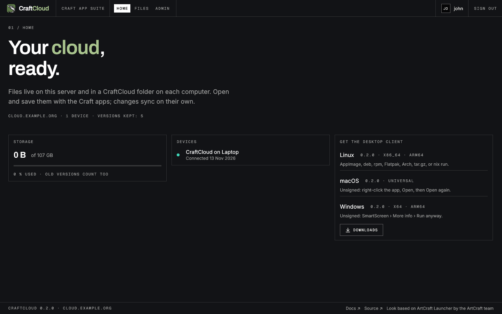
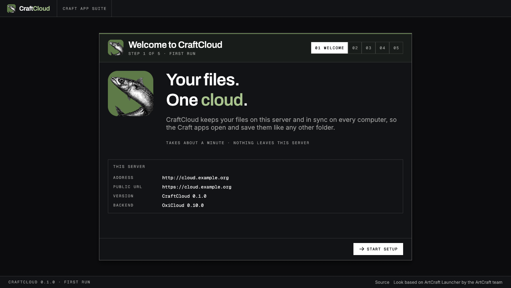
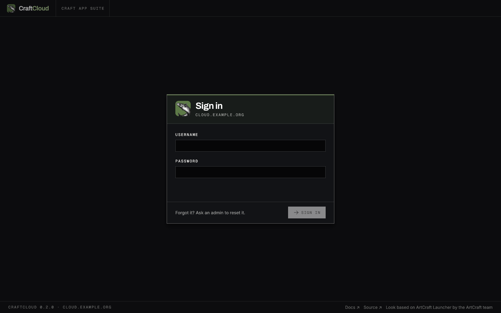

<p align="center">
  
</p>

<h1 align="center">CraftCloud</h1>

<p align="center">
  <b>Your own cloud for the Craft apps; self-hosted file sync, built in pure Rust.</b>
</p>

<p align="center">
  Files live on your server and in a CraftCloud folder on each computer, synced both ways like OneDrive or
  Nextcloud, so the Craft apps open and save them as ordinary local files. One Docker image for the server,
  a small desktop client for Linux, Windows and macOS.
</p>

<p align="center">
  
  
  
  
  
</p>

<p align="center">
  <a href="#run-the-server"><b>Run the server</b></a> ·
  <a href="#downloads"><b>Get the desktop client</b></a> ·
  <a href="https://getartcraft.com/apps">The Craft App Suite</a>
</p>

<br>

<p align="center">
  
  <br><sub>The web home page of a CraftCloud server.</sub>
</p>

<p align="center">
  <a href="#what-it-does">What it does</a> ·
  <a href="#features">Features</a> ·
  <a href="#a-tour">A tour</a> ·
  <a href="#run-the-server">Run the server</a> ·
  <a href="#status">Status</a> ·
  <a href="#downloads">Downloads</a> ·
  <a href="#build-from-source">Build from source</a> ·
  <a href="#the-craft-app-suite">Craft App Suite</a> ·
  <a href="#license-and-credits">License</a>
</p>

## What it does

The Craft apps work on files on your computer. CraftCloud keeps those files on a server you run and in sync on
every computer you use: save a document in WordCraft on one machine and it is there, in the same folder, on the
next. The server is [OxiCloud](https://github.com/AtalayaLabs/OxiCloud), run unmodified, with CraftCloud's own web
frontend and setup in front of it. The desktop client lives in the tray and keeps a local folder in step with the
server.

## Features

<table>
  <tr>
    <td width="33%" valign="top">
      <h3>🔄 A real sync folder</h3>
      Two-way sync of the folders you choose. Changes made in two places become a conflict copy, never a silent
      overwrite, and the last 5 versions of every overwritten file are kept.
    </td>
    <td width="33%" valign="top">
      <h3>🏠 Your own server</h3>
      One Docker image (or a NixOS module) on a VPS or a home server. A five-step setup in the browser, or one
      command in the terminal. Your files never leave it.
    </td>
    <td width="33%" valign="top">
      <h3>🔐 Sign in through the browser</h3>
      The desktop client never sees your password: you approve it on your server's page, and it keeps its token in
      the system keychain.
    </td>
  </tr>
  <tr>
    <td width="33%" valign="top">
      <h3>🧭 Always at hand</h3>
      Sync now, pause, open the folder or the web page from the tray. Starts at login if you want it to.
    </td>
    <td width="33%" valign="top">
      <h3>🌐 Craft apps in the browser (optional)</h3>
      The <code>-apps</code> image also serves the Craft web apps, to use without installing anything (opening
      cloud files in them is planned). Off by default; switch it on, app by app.
    </td>
    <td width="33%" valign="top">
      <h3>🦀 Pure Rust</h3>
      The client and the web frontend are egui, the server's own pieces are small Rust services. No Electron, no
      Node.
    </td>
  </tr>
</table>

## A tour

<p align="center">
  
  <br><sub><b>First run.</b> Five short steps: the owner account, the public address and whether the Craft apps run in the browser.</sub>
</p>

<p align="center">
  
  <br><sub><b>Sign in.</b> The same page approves a desktop client: it shows the client's code, and you approve or deny it.</sub>
</p>

## Under the hood

A Cargo workspace laid out like the ArtCraft Launcher: `crates/core` (the OxiCloud API and the sync decisions),
`crates/native` (the sync engine, keychain and settings), `crates/ui-egui` (every screen, for both the client and
the web), `apps/craftcloud` (desktop), `apps/craftcloud-web` (web), `apps/craftcloud-admin` (the image's settings
service) and `xtask`. Inside the image, Caddy fronts OxiCloud, the web frontend and the optional Craft web apps.
Single sign-on with an OpenID Connect provider: [docs/OIDC.md](docs/OIDC.md).

More in [docs/ARCHITECTURE.md](docs/ARCHITECTURE.md); the OxiCloud gaps CraftCloud works around, and the upstream
fixes it proposes, are in [docs/UPSTREAM.md](docs/UPSTREAM.md).

Also in `docs/`: [ROADMAP.md](docs/ROADMAP.md) and [STATUS.md](docs/STATUS.md) (where it stands),
[CLI.md](docs/CLI.md) (the command line), [CRAFT-INTEGRATION.md](docs/CRAFT-INTEGRATION.md) (how the Craft apps open
and save), [FILES-ON-DEMAND.md](docs/FILES-ON-DEMAND.md) (a design), [RELEASE-NOTES.md](docs/RELEASE-NOTES.md) and
the [design notes](docs/design-notes/) of each UI pass.

## Run the server

You need Docker with Compose. CraftCloud runs as two containers: CraftCloud itself and PostgreSQL.

```sh
git clone https://github.com/jonasbove/craftcloud
cd craftcloud
cp .env.example .env        # then edit it, see below
docker compose up -d        # pulls ghcr.io/jonasbove/craftcloud (amd64 and arm64)
```

| Setting in `.env` | What to put |
|---|---|
| `POSTGRES_PASSWORD` | A long random value: `openssl rand -hex 24` |
| `CRAFTCLOUD_PUBLIC_URL` | The address people type, e.g. `https://cloud.example.org` |
| `CRAFTCLOUD_BIND` | `127.0.0.1` behind a reverse proxy; a LAN or VPN address to reach it directly |
| `CRAFTCLOUD_HOST_PORT` | The host port (default `8086`) |
| `OXICLOUD_COOKIE_SECURE` | `true` when served over HTTPS |
| `CRAFTCLOUD_WEB_APPS` | `on` to run the Craft apps in the browser (needs the `-apps` image) |

Then open the public URL and follow the setup, or create the owner from the terminal:

```sh
scripts/create-owner https://cloud.example.org     # the first account; asks for username, email, password
scripts/add-user https://cloud.example.org         # everyone after that (signs in as an admin first)
```

**HTTPS:** anything beyond a private network should sit behind a TLS reverse proxy (Caddy, nginx, Traefik) that
forwards to `CRAFTCLOUD_BIND:CRAFTCLOUD_HOST_PORT`.

**Images:** every release publishes `ghcr.io/jonasbove/craftcloud:<ver>` and `:latest` (slim), and `:<ver>-apps`
and `:latest-apps` with the Craft apps for the browser (about 770 MB to download, 2.1 GB on disk). The same
images are on Docker Hub as `jonasbove/craftcloud` (`docker.io/jonasbove/craftcloud:<ver>`). To choose
when you update, pin a version in `.env`: `CRAFTCLOUD_IMAGE=ghcr.io/jonasbove/craftcloud:0.1.0`. Each image
carries a signed build-provenance attestation:
`gh attestation verify oci://ghcr.io/jonasbove/craftcloud:<ver> --repo jonasbove/craftcloud`.

**With the Craft apps in the browser:** `CRAFTCLOUD_IMAGE=ghcr.io/jonasbove/craftcloud:latest-apps` (or a pinned
`:<ver>-apps`) and `CRAFTCLOUD_WEB_APPS=on` in `.env`, then `docker compose up -d`.

**Building it yourself:** `docker compose build` builds the slim image from your checkout (a few minutes);
`docker build --target with-apps -t craftcloud:local-apps .` the `-apps` one.

**Backups:** the database and the `storage` volume, taken together: [docs/BACKUP.md](docs/BACKUP.md).

**Updating:** take a backup and read [RELEASE-NOTES.md](docs/RELEASE-NOTES.md), then `docker compose pull` and `docker compose up -d`
(after `git pull` if you build it yourself). Files and accounts live in the `storage` and `pg_data` volumes and
survive updates.

### NixOS

The flake has a NixOS module: the CraftCloud container plus NixOS's own PostgreSQL.

```nix
# flake.nix
inputs.craftcloud = {
  url = "github:jonasbove/craftcloud";
  inputs.nixpkgs.follows = "nixpkgs";
};
```

```nix
# configuration.nix (with specialArgs = { inherit inputs; })
{ inputs, ... }: {
  imports = [ inputs.craftcloud.nixosModules.default ];
  virtualisation.oci-containers.backend = "docker";   # or podman
  services.craftcloud = {
    enable = true;
    publicUrl = "https://cloud.example.org";
    environmentFile = "/run/secrets/craftcloud.env";  # POSTGRES_PASSWORD=…, kept out of the Nix store
    # listenAddress = "127.0.0.1"; port = 8086; dataDir = "/var/lib/craftcloud"; webApps = false;
  };
}
```

`image` defaults to `ghcr.io/jonasbove/craftcloud:latest`; set `services.craftcloud.image` to a pinned version
(`ghcr.io/jonasbove/craftcloud:0.1.0`), the `-apps` image, or your own registry's.

## Status

CraftCloud is in **early alpha**: version 0.1.0 is the first release. [**docs/ROADMAP.md**](docs/ROADMAP.md) has
where each part stands, the milestones and what's next; [docs/STATUS.md](docs/STATUS.md) what works, how it was
checked, and the known limits.

**What works:** the server image and its first-run setup, the desktop client's two-way sync folder (versions,
conflict copies, sign-in through the browser), the web file browser, admin pages for users and server settings,
single sign-on, the command line, and the `craftcloud` contract the Craft apps and the launcher can use.

**What's missing:**
- code-signed desktop builds (macOS and Windows ask once before the first start);
- opening cloud files in the Craft web apps in the browser;
- `craftcloud://` links on macOS (they need an Apple Event handler) and command-line output from Windows release
  builds;
- files on demand (a [design](docs/FILES-ON-DEMAND.md) only).

> [!IMPORTANT]
> Keep a backup of anything you sync with CraftCloud. When updating, update every computer that syncs an account
> together; see [docs/RELEASE-NOTES.md](docs/RELEASE-NOTES.md).

## Downloads

Every release on the [releases page](https://github.com/jonasbove/craftcloud/releases) has the same set of files as
the Craft apps' releases. The desktop client also comes from the Nix flake or from source. `<ver>` is the version
number, for example `0.1.0`.

The builds are **not code-signed** by Apple or Microsoft yet, so your system asks once before the first start.

**Windows** (10 and 11, x64 and arm64)

| File | What it is |
|---|---|
| `craftcloud-<ver>-windows-{x64,arm64}.msi` | Installer, for you only (no administrator rights). SmartScreen: **More info › Run anyway** |
| `craftcloud-<ver>-windows-{x64,arm64}-portable.zip` | The same `craftcloud.exe`, to run without installing |

**macOS** (11 or later, Apple silicon and Intel)

| File | What it is |
|---|---|
| `craftcloud-<ver>-macos-universal.dmg` | Drag `CraftCloud.app` to Applications, then **right-click › Open › Open** the first time (or `xattr -dr com.apple.quarantine /Applications/CraftCloud.app`) |

**Linux** (x86_64 and aarch64)

| File | What it is |
|---|---|
| `craftcloud-<ver>-linux-<arch>.deb` | Debian, Ubuntu, Mint, Pop!_OS (`sudo apt install ./craftcloud-….deb`) |
| `craftcloud-<ver>-linux-<arch>.rpm` | Fedora, openSUSE, RHEL (`sudo dnf install ./craftcloud-….rpm`) |
| `craftcloud-<ver>-linux-<arch>.pkg.tar.zst` | Arch Linux (`sudo pacman -U craftcloud-….pkg.tar.zst`); AUR recipes are in `packaging/arch/` |
| `craftcloud-<ver>-linux-<arch>.flatpak` | Flatpak (`flatpak install --user craftcloud-….flatpak`); "Start at login" doesn't work from it yet |
| `craftcloud-<ver>-linux-<arch>.AppImage` | Any distro: make it executable and run it. The `.zsync` next to it lets AppImage updaters fetch only what changed |
| `craftcloud-<ver>-linux-<arch>.tar.gz` | The binary, menu entry, icons and `install.sh` |

```sh
tar xzf craftcloud-<ver>-linux-x86_64.tar.gz
cd craftcloud-<ver>-linux-x86_64
./install.sh            # to ~/.local, no root; ./install.sh --remove undoes it
```

CraftCloud then shows up in your app launcher. It lives in the tray (StatusNotifierItem): KDE, Xfce, Cinnamon and
most desktops show it; on GNOME install the AppIndicator extension, on Hyprland or Sway add Waybar's `tray` module.
**Settings › Start at login** writes an XDG autostart entry, which GNOME, KDE and Xfce run; on Hyprland use
`exec-once = craftcloud --hidden` (Sway: `exec craftcloud --hidden`).

FreeBSD (`craftcloud-<ver>-freebsd-{x86_64,aarch64}.tar.gz`) and Linux riscv64 (`.deb`, `.rpm`, `.tar.gz`) builds are
attempted too, but CraftCloud has never been tried there; a release may come without them.

**Checking a download**

Every release has `SHA256SUMS.txt`. Check the files you downloaded against it:

```sh
sha256sum -c SHA256SUMS.txt --ignore-missing              # macOS: shasum -a 256 -c SHA256SUMS.txt --ignore-missing
```

Every file also has a GPG signature (`.asc`) next to it, made with the CraftCloud release key
`97062AFE35FFD84487658C6DD11DD5C65CF191CE` ("CraftCloud releases"). Its public key is `release-signing-key.asc`,
on every release and in this repository. Import it once and check that the fingerprint matches, then:

```sh
gpg --import release-signing-key.asc
gpg --verify SHA256SUMS.txt.asc SHA256SUMS.txt
gpg --verify craftcloud-<ver>-linux-x86_64.AppImage.asc craftcloud-<ver>-linux-x86_64.AppImage
```

Each file also carries a signed build-provenance attestation that ties it to this repository's release workflow
and the commit it was built from ([GitHub CLI](https://cli.github.com)):

```sh
gh attestation verify craftcloud-<ver>-macos-universal.dmg --repo jonasbove/craftcloud
```

**Nix and NixOS**

```sh
nix run github:jonasbove/craftcloud
```

To keep it installed and updatable, add the flake input above and install the package
(`inputs.craftcloud.packages.${pkgs.stdenv.hostPlatform.system}.default`, in `environment.systemPackages` or
Home Manager's `home.packages`). It brings its own menu entry and icons. Update with
`nix flake update craftcloud` and a rebuild.

### Connect a computer

1. Start CraftCloud and enter your server's address.
2. A browser tab opens on your server: sign in and approve the code it shows.
3. Choose the local folder (`~/CraftCloud` by default) and the server folders to sync.

### Command line

The desktop client is also a command line: with a command, `craftcloud` runs it and exits instead of opening a
window. It uses the same sign-in as the desktop client.

```sh
craftcloud login cloud.example.org      # sign in through the browser
craftcloud ls Documents                 # list, get, put, mv, cp, rm, trash, search, share, versions
craftcloud put report.pdf Documents/
craftcloud status                       # the desktop client's sync; also sync, pause, resume
craftcloud daemon                       # sync without a window, e.g. on a server
craftcloud server users ls              # admin: people and server settings
```

Every command takes `--json` for scripts. The reference, with exit codes and JSON shapes, is in
[docs/CLI.md](docs/CLI.md).

## Build from source

You need a recent stable Rust. On Linux, install the windowing headers first (Debian/Ubuntu:
`sudo apt install libxkbcommon-dev libwayland-dev libx11-dev libxrandr-dev libxi-dev libgl1-mesa-dev`).

```sh
git clone https://github.com/jonasbove/craftcloud
cd craftcloud
cargo run --release -p craftcloud    # the desktop client
cargo xtask ci                       # fmt, clippy, tests and the wasm build
```

The web frontend builds with [trunk](https://trunk-rs.github.io/trunk/) (`cd apps/craftcloud-web && trunk serve`);
the server image builds it for you. `nix develop` gives a shell with everything.

## The Craft App Suite

CraftCloud is made for the **Craft App Suite**, the free, open-source creative apps from the
[ArtCraft](https://getartcraft.com/) team, installed with the [ArtCraft Launcher](https://github.com/storytold/craft-launcher).
Every one of them works with CraftCloud through the sync folder. The `-apps` image bundles their web builds at the
versions pinned in [`apps.toml`](apps.toml), which also says which app opens which files.

| App | What it's for | Opens by default | Web build pinned | Code |
|:----|:--------------|:-----------------|:----------|:-----|
| **WordCraft** | Writing and document design | `.docx`, `.docm`, `.dotx`, `.dotm` … | 0.18.1 | [Code](https://github.com/storytold/wordcraft) |
| **GridCraft** | Spreadsheets and data | `.xlsx`, `.xlsm`, `.xls`, `.xlsb` … | 0.19.1 | [Code](https://github.com/storytold/gridcraft) |
| **DeckCraft** | Presentations and slide shows | `.deckcraft`, `.pptx`, `.potx`, `.ppsx` | 0.18.1 | [Code](https://github.com/storytold/deckcraft) |
| **PdfCraft** | Reading, organizing and protecting PDFs | `.pdf` | 0.21.1 | [Code](https://github.com/storytold/pdfcraft) |
| **FigCraft** | Interface design and prototyping | `.figcraft`, `.fig`, `.jam`, `.penpot` … | 0.18.1 | [Code](https://github.com/storytold/figcraft) |
| **CADCraft** | Computer-aided design and drafting | `.dxf`, `.dwg` | 0.20.1 | [Code](https://github.com/storytold/cadcraft) |
| **FilmCraft** | Video editing, color and sound | `.fcproj`, `.mp4`, `.mov`, `.m4v` … | 0.20.1 | [Code](https://github.com/storytold/filmcraft) |
| **LightCraft** | Photo library and raw development | `.dng`, `.cr2`, `.cr3`, `.nef` … | 0.21.1 | [Code](https://github.com/storytold/lightcraft) |
| **VectorCraft** | Vector illustration | `.vectorcraft`, `.drawcraft`, `.svg`, `.svgz` … | 0.24.1 | [Code](https://github.com/storytold/vectorcraft) |
| **EffectCraft** | Motion graphics and visual effects | `.ecproj`, `.aep`, `.aepx` | 0.24.1 | [Code](https://github.com/storytold/effectcraft) |
| **PhotoCraft** | Image editing | `.pcraft`, `.psd`, `.psb`, `.ora` … | 0.23.1 | [Code](https://github.com/storytold/photocraft) |
| **DesignCraft** | Page layout and publishing | `.designcraft`, `.idml`, `.indd`, `.indt` | 0.20.1 | [Code](https://github.com/storytold/designcraft) |
| **SoundCraft** | Recording, editing and mixing audio | `.scraft`, `.scraftz`, `.wav`, `.flac` … | 0.20.1 | [Code](https://github.com/storytold/soundcraft) |
| **TextureCraft** | 3D texture painting | `.tcraft`, `.glb`, `.gltf`, `.fbx` … | 0.6.1 | [Code](https://github.com/storytold/texturecraft) |
| **MaterialCraft** | Procedural material design | `.mcraft`, `.sbs` | 0.4.1 | [Code](https://github.com/storytold/materialcraft) |

`.md` and `.txt` open in WordCraft. In the browser, VectorCraft, EffectCraft, PhotoCraft, DesignCraft, SoundCraft,
TextureCraft and MaterialCraft will go through CraftCloud's shim and are marked experimental
([docs/CRAFT-INTEGRATION.md](docs/CRAFT-INTEGRATION.md)).

## License and credits

CraftCloud is dual-licensed under [MIT](LICENSE-MIT) or [Apache-2.0](LICENSE-APACHE), at your option.
Copyright (c) 2026 the CraftCloud contributors. Third-party work it includes or adapts is listed in [NOTICE](NOTICE).

Its look follows the [ArtCraft Launcher](https://github.com/storytold/craft-launcher) (MIT OR Apache-2.0). CraftCloud
is not made by or affiliated with the ArtCraft team, and uses none of their logos or marks. The server is
[OxiCloud](https://github.com/AtalayaLabs/OxiCloud) (MIT). Fonts: Inter, Archivo and Geist Mono (SIL Open Font
License).
